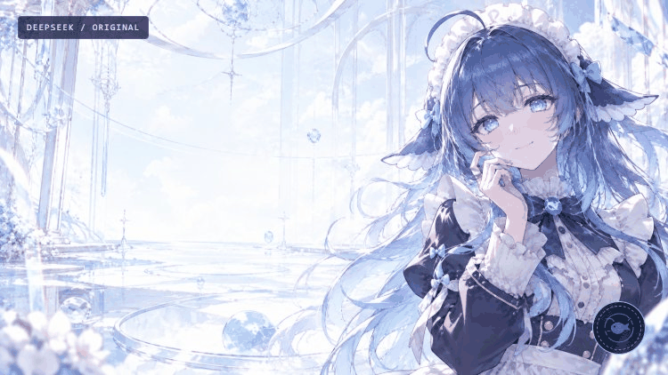
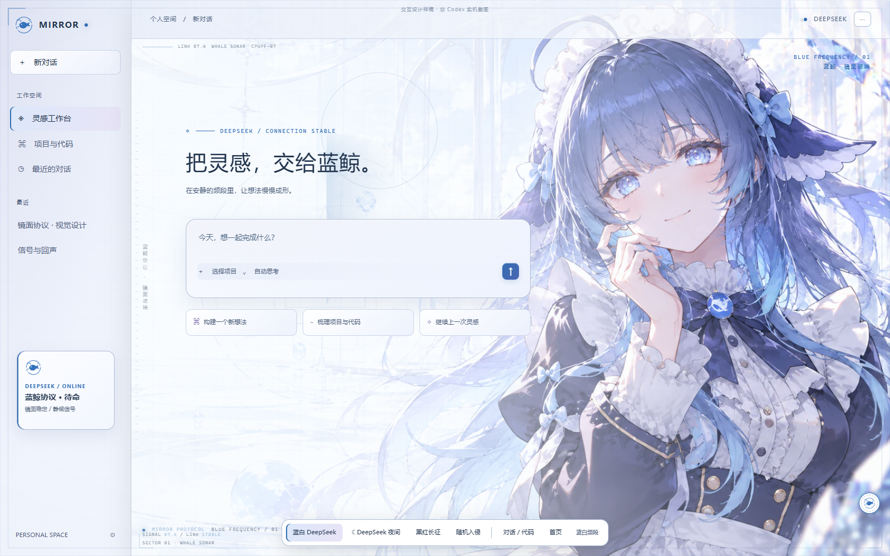
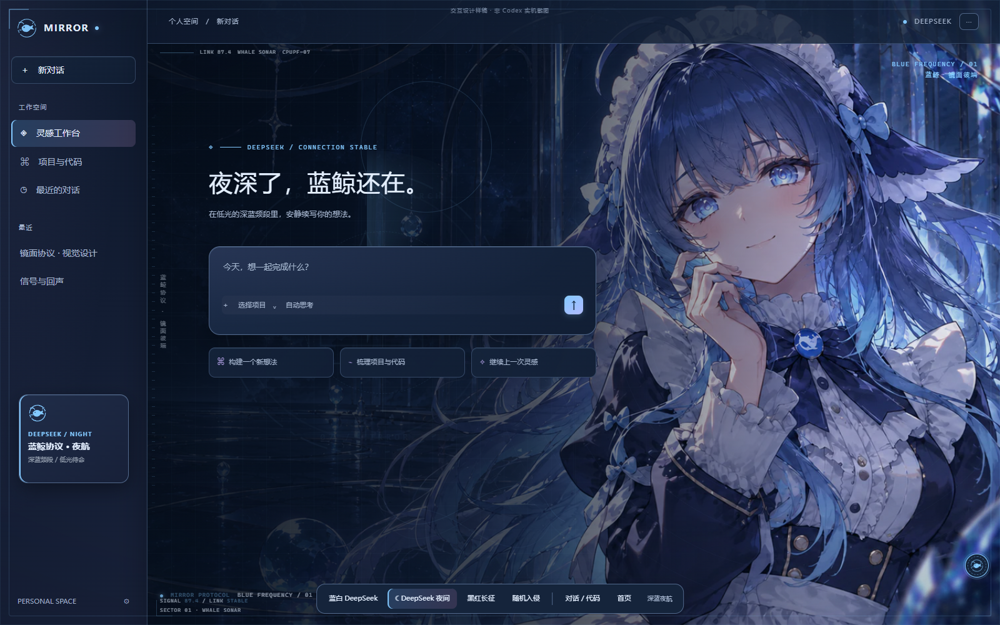
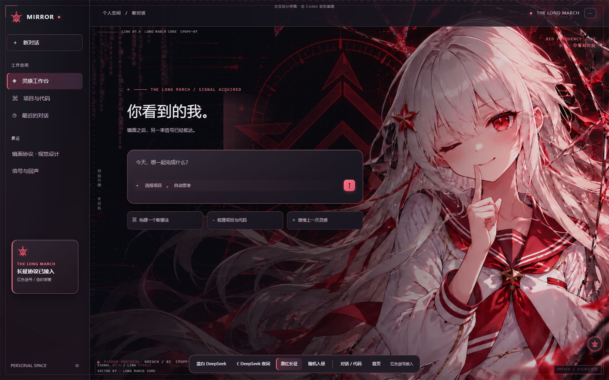
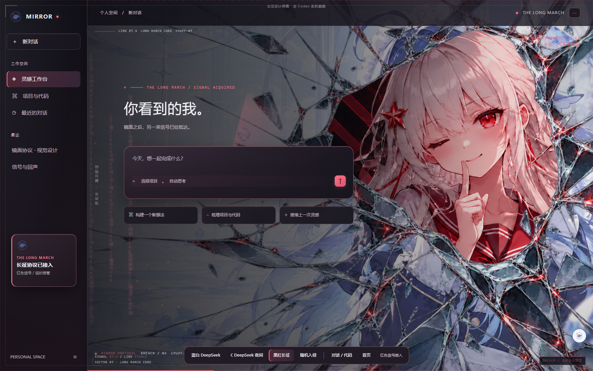
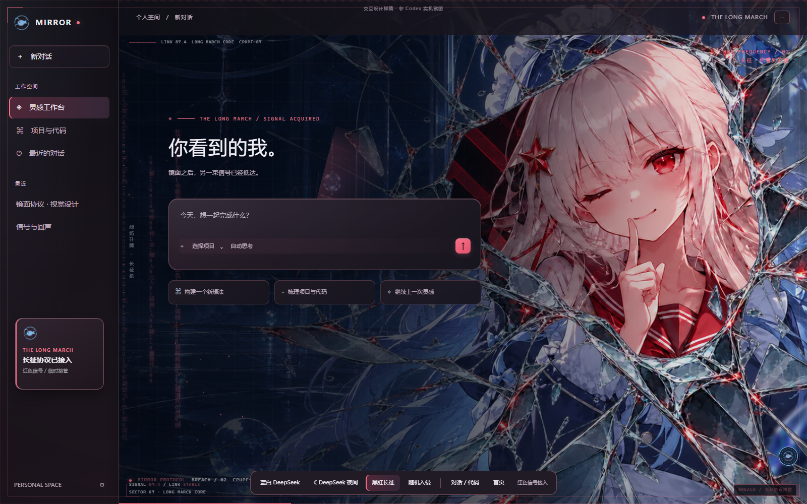

# 镜面协议 · Mirror Protocol

DeepSeek 蓝白日间 / 深蓝夜间，与黑红长征机之间的低频随机入侵主题。


**v2.3.2 · 实验性桌面主题。** 已通过独立 Edge 浏览器夹具验证；真实 Codex 兼容性尚未验收。非 OpenAI、DeepSeek、TFR 或 CD Projekt Red 官方项目。

## 直接让 Codex 安装

把 https://github.com/Yog-Sothoth29/mirror-protocol 发给 Codex，说：

> 请读取 INSTALL.md，为我下载安装镜面协议并尝试应用。使用仓库的安装器，安装后验证状态并给出恢复命令；如果第一次激活需要重启，先说明原因并征得同意。

其他 Codex 可按 [INSTALL.md](INSTALL.md) 与 [AGENTS.md](AGENTS.md) 执行。需要 Node.js 22+；下载源码后仅运行：

```sh
git clone https://github.com/Yog-Sothoth29/mirror-protocol.git
cd mirror-protocol
node tools/install.mjs
```

无需管理员权限或 npm 依赖。安装到 `~/.mirror-protocol`，保留四套主题、版本摘要和恢复入口。激活：

```powershell
node "$HOME/.mirror-protocol/mirror.mjs" use mirror-protocol-auto
node "$HOME/.mirror-protocol/mirror.mjs" status --json
node "$HOME/.mirror-protocol/mirror.mjs" verify --screenshot "$HOME/mirror-protocol-check.png"
```

若普通启动后无法激活，可运行 `node "$HOME/.mirror-protocol/activate-after-exit.mjs"`，然后从菜单完全退出 Codex；程序等待退出后仅启动一次主题版。

安装器不会自动重启；首次启用本机调试端口可能需要一次获准的正常重启。[Windows 兼容说明](WINDOWS-COMPATIBILITY.md)。

## 独立预览

开发和浏览器预览才需要依赖：

```sh
npm ci
npm run preview
```

打开 http://127.0.0.1:8791/Demo.html，点击「演示破碎切换 · 3.6秒」。服务只监听本机，预览不会连接或重启 Codex。`Transition.html` 可直接离线观看转场。



## 模式图片

以下是独立浏览器界面预览，不是本机 Codex 实机截图。

| 日间 | 夜间 | 长征机 |
|---|---|---|
|  |  |  |

| 日间碎镜 | 夜间碎镜 |
|---|---|
|  |  |

[复制给其他 Codex 的安装提示词](INSTALL-PROMPT.md)

## 有什么

- 蓝白 DeepSeek、深蓝夜间、黑红长征机三套完整配色，以及自动频段主题。
- DS在0.18–0.42秒快速进入碎镜，定格到1.28秒；随后通过源图轮廓斜向拖尾与六段不等长局部像素置换交接长征机。总长3.6秒，圆形手动按钮固定，保留少量条纹，没有全屏明暗频闪。
- 蓝白或夜间基底 6–14 分钟后随机进入长征机，停留 25–70 秒；输入、IME、菜单、弹窗、后台时延后。
- 正圆手动按钮固定，可锁定状态或恢复自动；减弱动态效果直接切换。
- 半屏布局、代码/菜单/输入配色、回退与清理。

自动调度和动画属于本仓库的便携 runtime；单独导入静态 .codex-theme 文件不会带上自动调度脚本。

## 构建与测试

~~~sh
npm run build
npm test
npm run release
~~~

生成的四个包位于 packages/，可安装的完整发布目录位于 dist/，均不提交源码仓库。浏览器测试另开终端保持预览服务运行，安装 Microsoft Edge 后运行 npm run test:browser。Linux CI 只验证构建和核心测试；不代表真实 Codex 实机验证。

## 恢复与卸载

```powershell
node "$HOME/.mirror-protocol/mirror.mjs" native
node "$HOME/.mirror-protocol/mirror.mjs" restore
node "$HOME/.mirror-protocol/uninstall.mjs"
```

`native` 保留管理器，`restore` 完整清理绘制与管理器，卸载仅删除本项目带所有权标记的安装目录。聊天与登录数据不受影响。

## 来源与许可

代码 MIT；便携运行时来自 [codex-theme-studio](https://github.com/Way-To-AGI/codex-theme-studio)，保留 [上游许可](runtime/LICENSE)。[素材许可](ASSET-LICENSE.md) 单列，MIT 不授予第三方角色、品牌或参考作品的权利。

角色插画为根据同人参考与用户简报制作的 AI 辅助视觉；不收录原作者参考图或模组美术。[来源记录](docs/SOURCES.md) · [Cyberpunk 动效研究](docs/CP2077-LOGO-RESEARCH.md) · [测试证据](docs/qa) · [贡献方式](CONTRIBUTING.md) · [发布准备](PUBLISHING.md)


当前2.3.1动效采用原作者分解参考的源图轮廓拖尾与六段不规则像素置换。详细核对范围见[研究记录](CP2077-LOGO-RESEARCH.md)。独立预览检查通过，未验收真实Codex。
